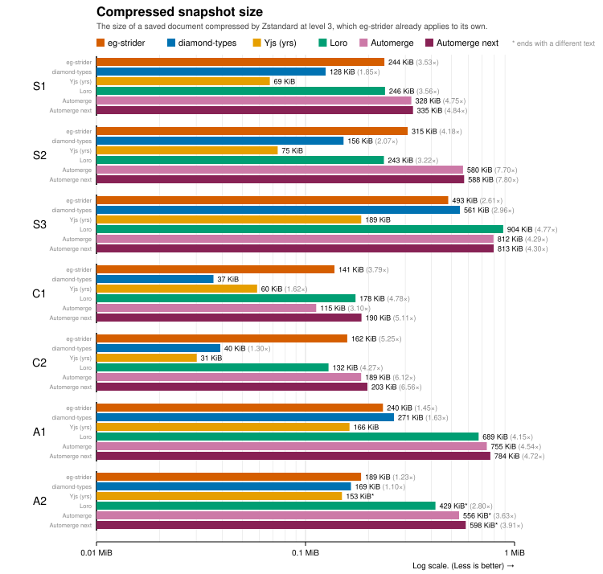

# eg-strider

[Eg-walker](https://jzhao.xyz/thoughts/Eg-walker) but faster!

> Eg-walker is a collaborative text-editing algorithm that is a blend of CRDT and OT.

## Results

Traces are the [editing histories published alongside Eg-walker](https://github.com/josephg/egwalker-paper/tree/master/datasets),
read from their diamond-types files, which keep each agent's name for breaking ties.

They contain 3 classes of traces:
- Sequential text editing traces (S)
- Concurrent text editing traces (C)
- Git commit and merge histories (A)




### Measurement details

- Every library starts from bytes in its own format, and every task ends once the text is
  read, so decoding, merging and reading count the same for all of them.
  - Merging starts from the library's encoding of the whole history. For eg-strider that is
    its saved file, with the saved text ignored and the history replayed from nothing. For
    diamond-types it is its history file, which the paper benchmarked. For Loro it is its
    exported updates. Yjs and Automerge are CRDTs whose saved document is their history, so
    their merge is loading it.
  - Reopening starts from the library's saved document. eg-strider and Loro leave the history
    unread until an edit needs it. diamond-types has no such document, so it is given what the
    paper uses: its history file beside a copy of the text.
- [diamond-types](https://github.com/josephg/diamond-types) is the implementation of
  Eg-walker that the paper benchmarked.
- Yjs is measured through yrs, its Rust port, with its default options (garbage collection
  on), saved as a v2 update as the paper's files are.
- Automerge is measured at 0.12, loading with its default checks. Each trace's Automerge
  changes are made once with 0.6.1, the last version without quadratic blowup when a replica
  applies a few changes at a time, which making the concurrent traces requires.
- Automerge next is Automerge's unreleased
  [hashless branch](https://github.com/automerge/automerge/tree/hashless) (at `7046d39`),
  through its `next` documents, which keep only the change hashes they need. It is handed
  the same documents as Automerge, converted once to the bundles it saves in, since loading
  older documents takes it through the path that rebuilds every change.
- Yjs and Automerge are measured on the paper's own files for each trace, which those
  libraries made themselves. Loro, which the paper has no files for, is measured on a replay
  of each trace with one replica per writer, each sent what its writer had seen. The harness
  makes the same replays into Yjs and Automerge, and prints them beside the paper's files.
- Peak memory counts the bytes being merged.
- Times are the p50 of 100 runs.

## Improvements

Where the history is linear, Eg-walker applies its edits one after another, with no CRDT,
so applying text operations is where most of a merge's time goes. Most of eg-strider's
gains come from making those text operations faster, taking the cheap path for as much of
the merge as possible, and skipping work that is already done or not yet needed.

- **Faster text operations: a piece table instead of a rope.** A rope keeps the text
  readable after every single edit. When merging history, especially if the number of
  edits to merge is large, we benefit from turning it into a bulk operation and only
  converting back to text at the very end. The piece table goes through the edits last to
  first and only tracks where each stretch of the document ends up in the final text, so
  text that a later edit deletes is never copied. This also improves on the metadata
  overhead and cache locality of a rope.
- **Maximizing cheap work: OT before CRDT for concurrent edits.** Eg-walker materializes
  its CRDT wherever the history is concurrent. eg-strider first tries to shift the way OT
  would and only falls back to the CRDT when concurrent edits land in the same span, or
  when a concurrent part of the history is very large. As this doesn't happen frequently,
  we can take the faster merge strategy much more often.
- **Saving work: incremental planning and lazy history.** Eg-walker works out which parts
  of the history are linear or concurrent, and builds a plan for the merge at the start
  of every replay. eg-strider keeps that split up to date as events are appended, which
  for most events means extending the last run. When more events arrive, the plan is
  rebuilt only from the first part they changed, and the CRDT's results for the parts
  before it are kept. Opening a saved document reads only its text. The history stays in
  compressed blocks cut at critical versions, and an edit made at an older version reads
  them back only to that version, merging into the text already there instead of
  replaying from the start.

## Caveats

eg-strider is a research project and makes the Eg-walker paper's assumptions: replicas are
not Byzantine, and every event is valid as in the paper's Definition C.1. As a result, we
do not check the validity at runtime and invalid events can cause eg-strider to panic.

Note that in any real-world implementation of these algorithms, there are bound to be
'incorrect' clients that will appear Byzantine and as a result, most of the libraries
benchmarked here need to guard against these invalid inputs to ensure convergence.

In preliminary testing, adding the same checks to eg-strider costs about 2–3% on the
concurrent traces and too little to measure on the others.

## Layout

- `crates/strider-graph`: the event graph, where it is linear, and the order concurrent
  events are visited in.
- `crates/strider-tree`: the B+ tree that holds the CRDT's records.
- `crates/strider-text`: the piece table that builds the final text.
- `crates/eg-strider`: the operation log, the replay and the saved document.
- `compare`: tests against diamond-types, and the benchmarks.

## Reproducing the results

Copy the paper's traces (`datasets/*.json` and `datasets/*.dt` from
[josephg/egwalker-paper](https://github.com/josephg/egwalker-paper), and its `.yjs` and
`.am` files to check the replays against) into `traces/paper/`, then:

```bash
cargo run --release -p compare -- --replay --reps 100 --json compare/figures/results.json traces/paper/*.json
```

```bash
python3 compare/figures.py compare/figures/results.json compare/figures
```
