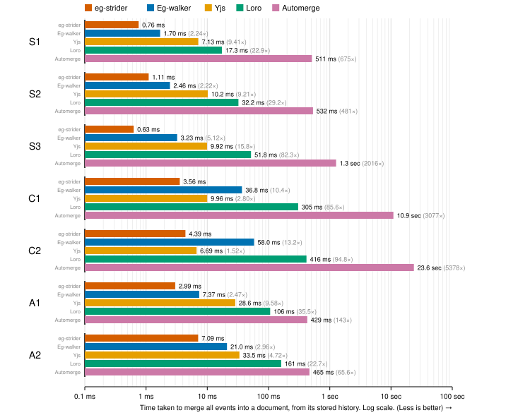
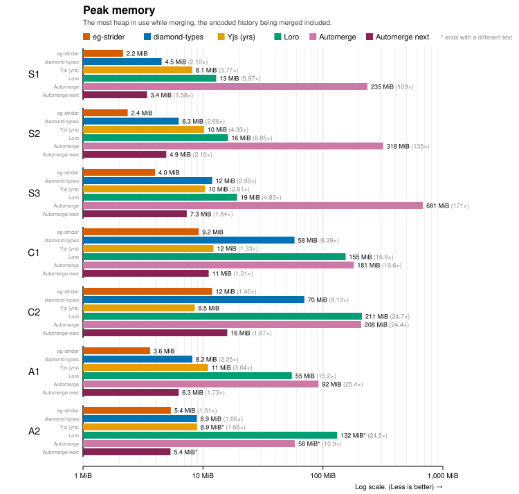
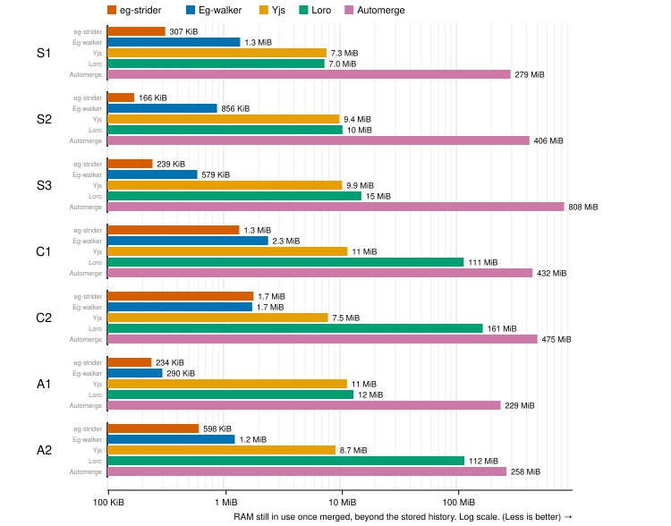

# eg-strider

A set of improvements on [Eg-walker](https://jzhao.xyz/thoughts/Eg-walker), the collaborative
text editing algorithm by [Gentle and Kleppmann](https://arxiv.org/abs/2409.14252), that make
replaying a document from its editing history faster while using less memory.

## Results





The traces are the ones from the paper, where S have no concurrent edits, C are two people
editing in real time, and A are git histories. Eg-walker is measured as diamond-types at
the revision the paper benchmarked and Yjs as its Rust port, all on an Apple M5 Pro.

## Why it is faster

- Concurrent edits that don't touch each other are merged without building a CRDT.
  Eg-walker builds its CRDT for any part of the history that has concurrency, while
  eg-strider first tries shifting each edit by the net length of the concurrent edits
  before it, the way operational transformation would, and only falls back to the CRDT
  when an edit lands in text that holds concurrent edits it hasn't seen. Two people typing
  at the same time are usually typing in different places, so the fallback is rare in the
  real-time traces: C1 has 3,650 concurrent parts of which only 25 need the CRDT, and none
  of C2's 4,825 do.
- The final text is assembled backwards from a piece table instead of forwards in a rope.
  Eg-walker applies every edit in order to a rope, whereas eg-strider only works out where
  each edit lands while merging, and then undoes the edits from last to first over a piece
  table of the final text, copying each surviving character once to its final position.
  This helps most when a lot of what gets typed is later deleted, since a rope has to
  insert and shift all of that text even though it won't be there at the end. In S1 only
  315k of the 547k characters typed survive, and in S3 only 122k of 1.2M.
- Looking up a CRDT record by the event that created it is an array read instead of a
  tree search. Eg-walker keeps a second B-tree from event ids to records, and goes through
  it every time it steps its view of the document back or forward by an event (the
  paper's retreat and advance). Because the events of one concurrent part are numbered
  consecutively, eg-strider can use a flat array instead. This matters on git histories
  because they branch and merge all the time: one part of A2 has 749 forks and 765 merges,
  and merging it steps back or forward 1.6 events for every event it applies.
- The graph is analysed as events are appended instead of at the start of every merge.
  Eg-walker works out where the history is linear, and a plan for the rest, each time it
  merges, while eg-strider keeps track of this on every append so that a replay doesn't
  begin with a pass over the graph. That pass was a real share of the work for C1, whose
  history is cut into 7,300 pieces.

## Why it still uses less memory

eg-strider holds on to more state than Eg-walker does, since the stored history also
records where it is linear and each replay saves what the CRDT resolved so that the next
one can skip it.

- What a replay saves for the next one is two numbers per insert or run of deletes in the
  parts that needed the CRDT, plus an index into the history, rather than anything per
  character. For A2's 698k events that comes to 0.4 MB.
- The CRDT state only exists for the parts of the history that need it, and it is freed
  before the text is built. On C1 and C2, where almost no part needs the CRDT, there is
  very little to hold while merging, and peak memory is about 12 times lower than
  Eg-walker's.
- While merging, each edit is stored as a single position, and the rest of the edit is
  read back from the history when the text is built, so the edits waiting to be undone
  cost a few bytes each.
- The document comes out as a string, while Eg-walker holds it as a rope, and a rope of
  S1's 0.3 MB of text takes 1.3 MB. This is most of the difference in memory held after
  merging, which is lower on every trace except C2, where the index into the history
  makes it about the same.

## Layout

- `crates/strider-graph`: the event graph, where it is linear, and the order concurrent
  events are visited in.
- `crates/strider-tree`: the B+ tree that holds the CRDT's records.
- `crates/strider-text`: the piece table that builds the final text.
- `crates/eg-strider`: the operation log and the replay.
- `compare`: tests against diamond-types, and the benchmarks.

## Reproducing the results

Copy the paper's traces (`datasets/*.dt` from
[josephg/egwalker-paper](https://github.com/josephg/egwalker-paper)) into `traces/`, then:

```bash
cargo run --release -p compare -- --replay --reps 25 --json compare/figures/results.json traces/*.dt
```

```bash
python3 compare/figures.py compare/figures/results.json compare/figures
```

The first run also replays each history into Yjs, Loro and Automerge, which takes several
minutes, and saves the results next to the trace so that later runs can reuse them.
