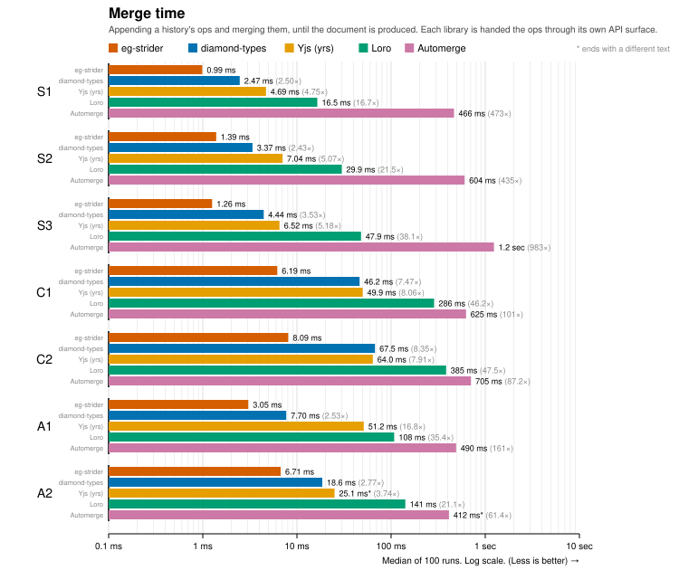
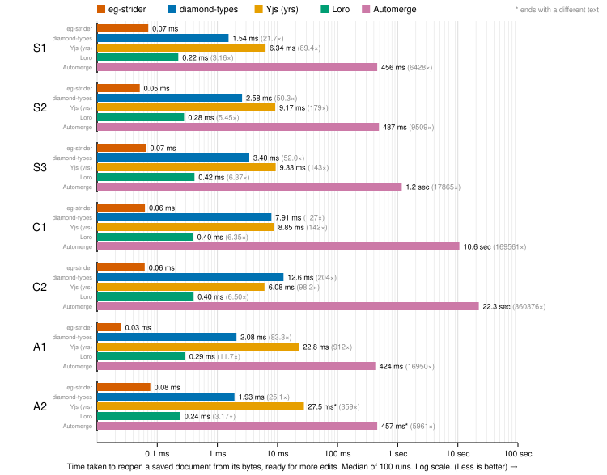
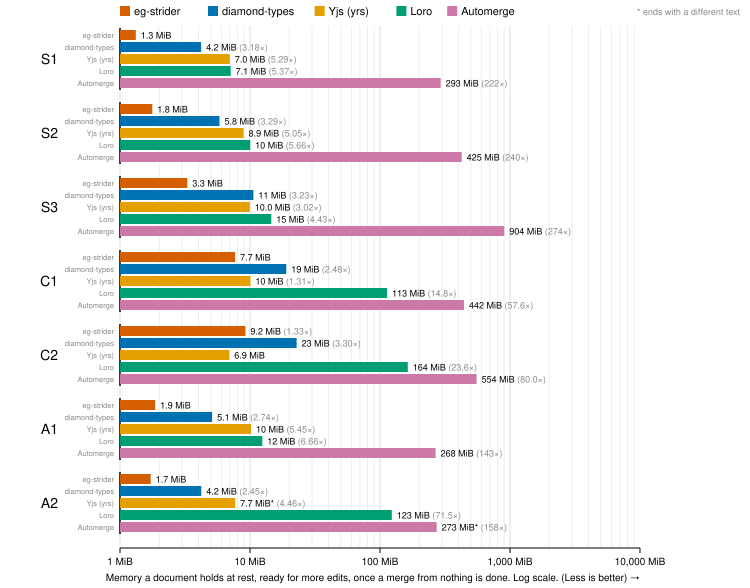
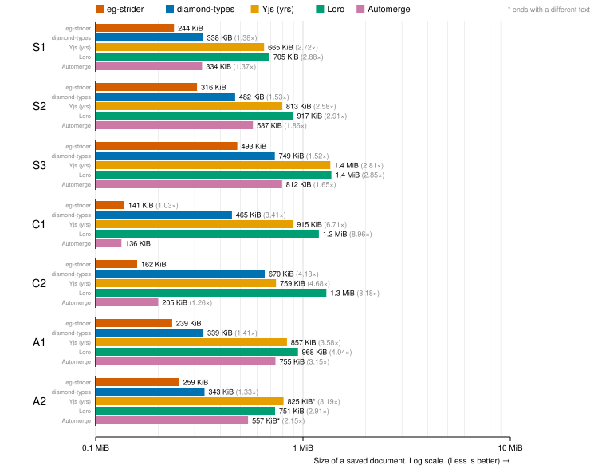

# eg-strider

[Eg-walker](https://jzhao.xyz/thoughts/Eg-walker) but faster!

> Eg-walker is a collaborative text-editing algorithm that is a blend of CRDT and OT.

## Results

Traces are sourced from the JSON versions of the [editing histories published alongside Eg-walker](https://github.com/josephg/egwalker-paper/tree/master/datasets).

They contain 3 classes of traces:
- Sequential text editing traces (S)
- Concurrent text editing traces (C)
- Git commit and merge histories (A)



Appending a history's ops and merging them, until the document is
produced. Each library is handed the ops through its own API surface.



From the bytes of a saved document (using each library's native format) until it is ready for more edits, with
all parsing counted. eg-strider and Loro leave the history unread until an edit needs it.
diamond-types has no saved document that skips the merge, so it is given what the paper
uses: its history file beside a copy of the text.


The most heap allocated while merging, the ops being merged included.



What a document holds once a merge from nothing is done, ready for
more edits.



The size of a saved checkpoint of a document.

### Measurement details

- [diamond-types](https://github.com/josephg/diamond-types) is the implementation of
  Eg-walker that the paper benchmarked. 
- Yjs is measured through yrs, its Rust port. 
- Automerge is measured at 0.12. Each trace's Automerge changes are made once with 0.6.1,
  the last version without quadratic blowup when a replica applies a few changes at a
  time, which making the concurrent traces requires. 0.12 then applies them all at once.
- Yjs runs with garbage collection off. 
- Times are the p50 of 100 runs. 

## Improvements

We attribute most of the improvements here to choice of data structures
and what kind of bookkeeping to keep up to date.

- **OT before CRDT for concurrent edits.** Eg-walker materializes its CRDT wherever the
  history is concurrent. eg-strider first tries to shift each edit past the concurrent
  edits before it, the way OT would, which only needs to track the few places those edits
  touched. It falls back to the CRDT when concurrent edits land in the same place, which
  is rare when people type in different parts of a document, or when a concurrent part of
  the history is very large.
- **A piece table instead of a rope.** A rope keeps the text readable after every single
  edit. When merging history, especially if the number of edits to merge is large, we
  benefit from turning it into a bulk operation and only converting back to text at the
  very end. The piece table only tracks where each stretch of the document ends up in the
  final text, which improves on the metadata overhead and cache locality of a rope.
- **Incremental planning.** Eg-walker works out which parts of the history are linear or
  concurrent, and builds a plan for the merge at the start of every replay.
  eg-strider keeps the split into linear and concurrent parts up to date as events are
  appended, so a replay starts from it and only has to look inside the concurrent parts.
  The cost moves to when events are appended, which the merge time counts.
- **Opening without reading the history.** A saved document holds its text, and its
  history in compressed blocks that each start at a critical version. Opening reads the
  text. An edit made at an older version reads the blocks back to that version and is
  merged into the text already there, instead of replaying from the start.
- **O(1) lookup of CRDT records.** Eg-walker finds the record for an event by searching a
  B-tree, which is O(log n) on every retreat and advance. Events in a concurrent part are
  numbered consecutively, so eg-strider indexes a flat array instead.

## Caveats

eg-strider is a research project and makes the Eg-walker paper's assumptions: replicas are
not Byzantine, and every event is valid as in the paper's Definition C.1. As a result, we
do not check the validity at runtime and invalid events can cause eg-strider to panic.

Note that in any real-world implementation of these algorithms, there are bound to be
'incorrect' clients that will appear Byzantine and as a result, most of the libraries
benchmarked here need to guard against these invalid inputs to ensure convergence.

In preliminary testing, adding the same checks to eg-strider costs about 2–3% on the
concurrent traces and too little to measure on the others.

## Layout

- `crates/strider-graph`: the event graph, where it is linear, and the order concurrent
  events are visited in.
- `crates/strider-tree`: the B+ tree that holds the CRDT's records.
- `crates/strider-text`: the piece table that builds the final text.
- `crates/eg-strider`: the operation log, the replay and the saved document.
- `compare`: tests against diamond-types, and the benchmarks.

## Reproducing the results

Copy the paper's traces (`datasets/*.json` from
[josephg/egwalker-paper](https://github.com/josephg/egwalker-paper), and its `.yjs` and
`.am` files to check the replays against) into `traces/paper/`, then:

```bash
cargo run --release -p compare -- --replay --reps 100 --json compare/figures/results.json traces/paper/*.json
```

```bash
python3 compare/figures.py compare/figures/results.json compare/figures
```
